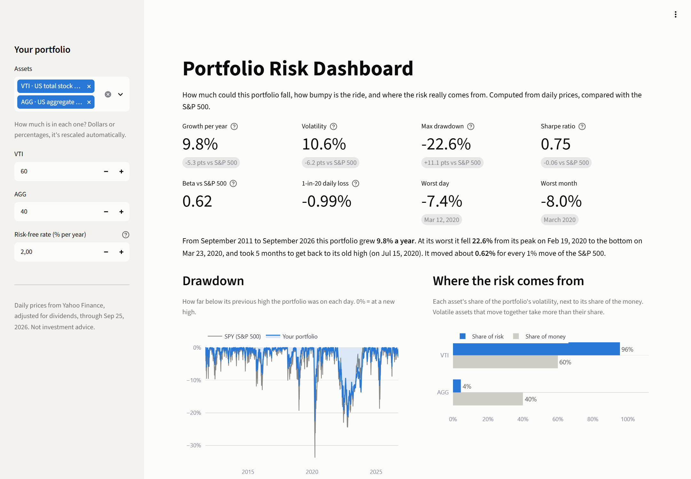

# Portfolio Risk Dashboard

**How risky is your portfolio, really?** Pick your funds and stocks and see how far the portfolio has fallen, how bumpy the ride was, and which holdings the risk actually comes from, measured on 15 years of daily prices and compared with the S&P 500.



[](https://github.com/Lucas123124124123123/portfolio-risk-dashboard/actions/workflows/tests.yml)


## What the data shows

From September 2011 to September 2026, with dividends reinvested:

- **A classic 60/40 portfolio (60% VTI stocks, 40% AGG bonds) put 95% of its risk in the stocks.** The 40% in bonds contributed less than 5% of the swings. "60/40" describes the money, not the risk.
- The 60/40 grew 9.8% a year against 15.1% for the S&P 500 (SPY), with about two-thirds of the volatility (10.6% vs 16.8%). Its worst fall was 22.6% (February-March 2020, recovered by July 2020); SPY's was 33.7%.
- **Two small stock positions can dominate a portfolio.** Moving 5% each into NVIDIA and Tesla (55% VTI, 35% AGG) makes those two 10% of the money but **27% of the risk**, because each swings about three times as much as the stock market.
- **Bonds don't always protect.** Over the whole period long-term Treasuries (TLT) tended to move against stocks (correlation -0.19), yet in 2022 stocks and bonds fell together: a 60% VTI / 40% TLT portfolio lost 27.9% from December 2021 to October 2022 and needed almost two years to recover, a deeper fall than the COVID crash.

Advisors and investors usually get these numbers from paid tools or build them in spreadsheets. This app computes them in a second from free data.

## What it does

- **Headline risk numbers**, each compared with the S&P 500: growth per year, volatility, max drawdown, Sharpe ratio, beta, 1-in-20 daily loss (95% VaR), worst day and worst month.
- **A plain-language summary:** "At its worst it fell 22.6% from its peak on Feb 19, 2020 to the bottom on Mar 23, 2020, and took 5 months to get back to its old high."
- **Drawdown chart:** how far below its previous high the portfolio was on every day, next to the S&P 500.
- **Risk contribution:** each holding's share of the portfolio's volatility next to its share of the money.
- **Rolling volatility:** one-year volatility over time, which shows how risk jumps in crises.
- **Correlation matrix** of the selected assets and the S&P 500.
- **Growth of $10,000** and a side-by-side table against SPY.

Every technical term in the app carries a one-line explanation.

## Quick start

```bash
git clone https://github.com/Lucas123124124123123/portfolio-risk-dashboard.git
cd portfolio-risk-dashboard
pip install -r requirements.txt
streamlit run app.py
```

The repository ships with a price snapshot, so it runs offline with no API keys or configuration.

## Method

**Assumption:** the portfolio is rebalanced back to its target weights **every day**, so its daily return is the weighted sum of the assets' daily returns. The analysis uses the days on which every selected asset has a price (META starts in May 2012). A year has 252 trading days.

| Measure | In plain words | Formula |
|---|---|---|
| Growth per year | The steady yearly return that ends at the same value | `(final / start) ^ (252 / days) - 1` |
| Volatility | How much the value typically swings in a year | `std(daily returns) × √252` |
| Max drawdown | The worst peak-to-bottom loss | `min(value / running max - 1)` |
| Sharpe ratio | Return above cash for each unit of volatility | `mean(daily return - daily risk-free) / std × √252` |
| Beta | How much it moves when the S&P 500 moves 1% | `cov(portfolio, SPY) / var(SPY)` |
| 1-in-20 daily loss | A loss exceeded on only 5% of days (historical VaR 95%) | `-(5th percentile of daily returns)` |
| Risk contribution | Share of the portfolio's volatility from each asset | `wᵢ × (Σw)ᵢ / (wᵀΣw)`, sums to 100% |

Σ is the covariance matrix of daily returns. A holding with a negative risk contribution lowers the portfolio's volatility.

## Data

Daily closes for 9 ETFs (SPY, QQQ, VTI, VEA, VWO, AGG, TLT, GLD, VNQ) and 10 large US stocks (AAPL, MSFT, NVDA, AMZN, GOOGL, META, TSLA, BRK-B, JPM, XOM) from September 2011 to September 2026, in [`data/daily_prices.csv`](data/daily_prices.csv).

The source is Yahoo Finance via [yfinance](https://github.com/ranaroussi/yfinance), with prices adjusted for splits **and dividends**, so every return is a total return.

To refresh the snapshot:

```bash
python scripts/update_prices.py              # every ticker, last 15 years
python scripts/update_prices.py NVDA TSLA    # some tickers
```

Tickers that Yahoo Finance does not return are tried on [Stooq](https://stooq.com). Stooq prices are adjusted for splits but **not for dividends**, which understates total return by roughly the dividend yield; the script prints a warning when it uses them. Stooq sometimes asks browsers to pass a check before serving files. In that case, download the daily CSV in your browser and import it:

```bash
python scripts/update_prices.py --file SPY path/to/spy_us_d.csv
```

## Project structure

```
app.py                     Streamlit dashboard
portfolio_risk/
  prices.py                download, read and write the price snapshot
  risk.py                  return, volatility, drawdown, beta, VaR and risk contribution
scripts/update_prices.py   refresh the snapshot
data/                      daily price snapshot
tests/                     unit tests on small hand-built return series
```

## Development

```bash
pip install -r requirements-dev.txt
pre-commit install
```

Every commit and every push runs the same checks:

| Check | Tool | Rule |
|---|---|---|
| Lint | ruff | pycodestyle, pyflakes, isort, bugbear, pyupgrade and more |
| Format | ruff format | no diff allowed |
| Types | mypy | `--strict` on the `portfolio_risk` package |
| Tests | pytest + pytest-cov | fails below 85% coverage |

The tests use return series short enough to check by hand: +10%, -50%, +100% has a known drawdown and recovery date, a 2x copy of the market has a beta of 2, and two uncorrelated assets split risk by their squared weights.

## Roadmap

- [ ] Monthly or yearly rebalancing instead of daily
- [ ] Custom tickers fetched on demand
- [ ] Stress tests: the portfolio through 2008, 2020 and 2022
- [ ] Hosted demo

## Disclaimer

For education and analysis only. This is not investment advice. Past risk doesn't guarantee future risk.

## License

[MIT](LICENSE)
